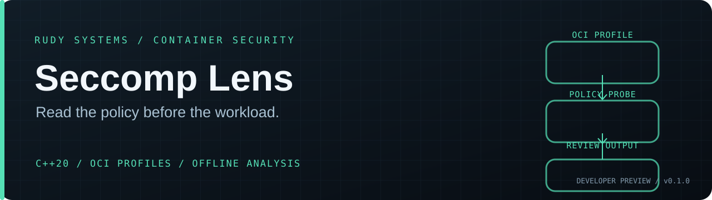

<p align="center"></p>

<p align="center">
  <a href="https://github.com/r4venrudy/rudy-seccomp-lens/actions/workflows/ci.yml"></a>
  
  
  
  <a href="LICENSE"></a>
</p>

<p align="center"><strong>Read the policy before the workload.</strong></p>
<p align="center"><a href="#capabilities">Capabilities</a> · <a href="#build">Build</a> · <a href="#try-it">Examples</a> · <a href="docs/CONTRACT.md">Contract</a> · <a href="https://rudy.systems">Rudy Systems</a></p>

---

**Rudy Seccomp Lens reviews Linux container seccomp profiles before deployment.**
It reads OCI `config.json` or a standalone `LinuxSeccomp` object, lints policy shape,
simulates a named syscall against six explicit argument values, and compares rule
declarations. It runs offline and does not require a container runtime, libseccomp,
Python, JavaScript, or third-party packages.

**v0.1.0 developer preview.** The probe is symbolic: it does not translate syscall
names to architecture-specific numbers or prove the filter a runtime installs.
Use the target runtime and an isolated test container to validate important policy
decisions.

```text
OCI config.json / LinuxSeccomp
            │
       bounded JSON parser
            │
     ┌──────┼───────────┐
     ▼      ▼           ▼
    lint   probe   structural diff
     │      │           │
     └──────┴─────┬─────┘
                  ▼
          text / JSON / SARIF
```

## Capabilities

| Capability | What it does |
| :--- | :--- |
| OCI input | Accepts full runtime config at `linux.seccomp` or a standalone seccomp profile |
| Policy lint | Flags allow-by-default profiles, empty kill-by-default profiles, repeated architecture/syscall declarations, wildcard names, invalid argument indexes and incompatible `errnoRet` use |
| Argument probe | Evaluates EQ, NE, LT, LE, GT, GE and MASKED_EQ against six supplied unsigned 64-bit argument values; refuses conflicting matches |
| Structural diff | Shows added, removed and changed named rules plus default action/errno, architecture and flag drift between two profiles |
| Pipeline output | Text, deterministic JSON and SARIF 2.1.0 with stable `RSL` rule identifiers |
| Bounded parser | No runtime dependencies; 8 MiB file limit, 64-level nesting limit, collection caps, duplicate-key rejection and strict UTF-8 validation |
| CI | CMake build and regression tests on Linux, Windows and macOS; Linux sanitizer run |

An allow-by-default result is a review lead, not a universal vulnerability verdict.
Workloads and deployment requirements differ. A runtime may also apply other
filters, and kernel, libseccomp, architecture and runtime behavior matter.

## Build

Requirements: CMake 3.20+ and a C++20 compiler. No package download is needed.

```sh
git clone https://github.com/r4venrudy/rudy-seccomp-lens.git
cd rudy-seccomp-lens
cmake -S . -B build -DCMAKE_BUILD_TYPE=Release
cmake --build build --parallel
ctest --test-dir build --output-on-failure
```

On Windows, run CMake from a Visual Studio Developer PowerShell or another shell
with a C++20 compiler configured. Visual Studio's multi-configuration generators
may place the executable under `build/Release/`.

## Try it

```sh
# Review a deny-by-default example and emit SARIF for code scanning.
seccomp-lens lint --format sarif --fail-on warning examples/deny-by-default.json

# Ask which named rule applies to openat with all six argument values supplied.
seccomp-lens probe examples/deny-by-default.json \
  --syscall openat --args 0,0,0,0,0,0

# Compare a deny-by-default example with a permissive baseline.
seccomp-lens diff --format json examples/deny-by-default.json examples/allow-by-default.json
```

Arguments use decimal or `0x` hexadecimal unsigned integers. The probe applies
every predicate in a matching rule; if no rule matches, it reports `defaultAction`.
For `SCMP_ACT_ERRNO` and `SCMP_ACT_TRACE`, an omitted errno is reported as EPERM.
If multiple matching rules disagree on action or errno, the command exits with an
ambiguity error instead of selecting one.

### Exit codes

| Code | Meaning |
| ---: | :--- |
| 0 | Review completed below the chosen lint threshold |
| 1 | `--fail-on` threshold reached |
| 2 | Usage, input, parser or output error |
| 3 | Probe found conflicting matching rules |

## Validation

The dependency-free test suite covers JSON bounds and Unicode, duplicate keys,
OCI and standalone profiles, linter findings, every supported argument comparator,
conflicting rules, JSON/SARIF validity, structural diffs and CLI examples.

```sh
cmake -S . -B build-sanitized -DCMAKE_BUILD_TYPE=Debug -DRSL_ENABLE_SANITIZERS=ON
cmake --build build-sanitized --parallel
ctest --test-dir build-sanitized --output-on-failure
```

Release automation reruns the tests and packages platform-specific archives for
Linux, Windows and macOS when a `v*` tag is pushed. Check the live workflow and
release page for current results and available binaries.

Read the [input/output contract](docs/CONTRACT.md), [security notes](SECURITY.md)
and [contribution guide](CONTRIBUTING.md). The input schema follows the
[Open Container Initiative Linux runtime specification](https://github.com/opencontainers/runtime-spec/blob/main/config-linux.md#seccomp).

---

<p align="center"><a href="LICENSE">MIT licensed</a> · Built by <a href="https://rudy.systems">Rudy Systems</a> · <a href="https://github.com/r4venrudy">r4venrudy</a></p>
